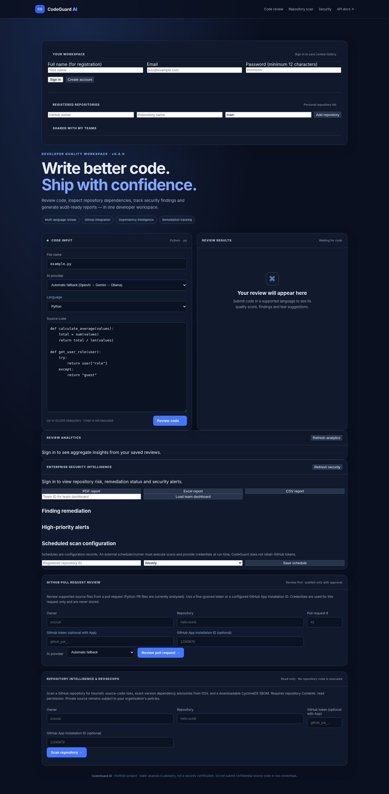
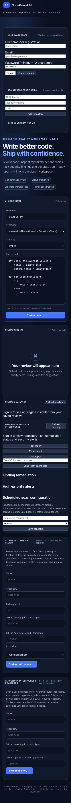
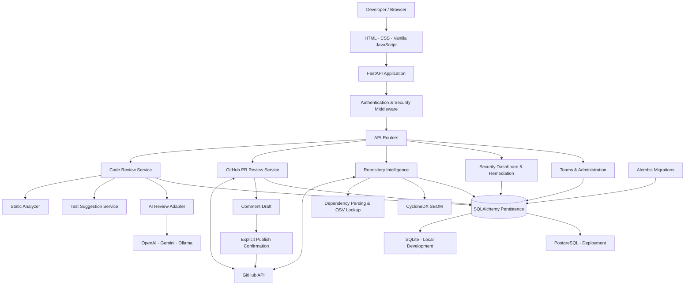

<div align="center">

# 🛡️ CodeGuard AI

### AI-assisted code review, repository security intelligence, and DevSecOps insights.

[](https://github.com/dhruv-nayak/CodeGuard-AI/actions/workflows/ci.yml)


[Overview](#overview) · [Features](#features) · [Architecture](#architecture) · [Getting Started](#getting-started) · [Security](#security-and-privacy) · [Roadmap](#project-status-and-roadmap)

**Repository:** [dhruv-nayak/CodeGuard-AI](https://github.com/dhruv-nayak/CodeGuard-AI)

</div>

---

## Overview

CodeGuard AI is a self-hostable developer workspace that combines static code checks, optional AI-assisted review, GitHub pull-request analysis, repository dependency intelligence, and security finding management.

The goal is to help developers understand potential code-quality and security issues, review suggested improvements, and keep track of findings across repository scans.

CodeGuard AI is an advisory tool. It does not execute submitted source code, and its heuristic checks are not a replacement for a full semantic static-analysis platform or an independent security assessment.

## Screenshots

The following images show the application interface in its initial, signed-out state. They are UI previews, not evidence of a live production deployment.

| Desktop dashboard | Mobile layout |
|---|---|
|  |  |

## Features

### Code review
- Direct code review through the web interface and REST API.
- Language options for Python, JavaScript, TypeScript, Java, PHP, SQL, and HTML.
- Python AST-based checks plus selected pattern-based checks for other supported languages.
- Optional AI review through OpenAI, Google Gemini, or a local Ollama endpoint.
- Configurable provider selection and fallback order.
- Findings, suggested code improvements, and generated test suggestions/modules.
- Per-user review history and review analytics.

### GitHub pull-request review
- Read pull-request metadata and changed files from GitHub.
- Analyze changed Python files in the current implementation.
- Generate line-specific comment drafts where the diff supports them.
- Publish comments only after a separate explicit confirmation.
- Publishing uses a GitHub `COMMENT` review event; the application does not approve, request changes, merge, or modify repository source.

### Repository intelligence
- Bounded, read-only GitHub repository scans.
- Static heuristic checks for supported Python, JavaScript/TypeScript, Java, PHP, SQL, and HTML source files.
- Dependency extraction from supported Python, npm, Composer, Maven, and Go manifests.
- Exact-version dependency vulnerability lookups through OSV.
- CycloneDX 1.5 JSON SBOM generation and download.
- Scan bounds limit repository tree entries, manifests, source files, and file sizes.

### Security operations and collaboration
- User-scoped security dashboard and scan trends.
- Team dashboards for repositories shared with a team.
- Finding remediation states: `open`, `in_progress`, `resolved`, `accepted_risk`, and `false_positive`.
- High-priority finding views and PDF, XLSX, and CSV exports.
- Daily/weekly schedule configuration records.
- Team membership, repository sharing, administration, and audit events.

> **Scheduling limitation:** CodeGuard AI stores schedule preferences but does not run a background scheduler or retain GitHub credentials for unattended scans. An external runner must execute scheduled scans and provide an authorized credential at run time.

## Architecture

The application is organized around a FastAPI backend, browser-based frontend, modular analysis services, optional AI-provider adapters, GitHub integration, and SQL persistence.



See [`docs/architecture.md`](docs/architecture.md) for component responsibilities, data flow, trust boundaries, and implementation limitations.

## Technology stack

| Layer | Technologies |
|---|---|
| Backend | Python 3.11+, FastAPI, Pydantic |
| Frontend | HTML5, CSS3, vanilla JavaScript |
| Static analysis | Python AST and language-specific heuristic checks |
| AI providers | OpenAI, Google Gemini, Ollama (optional) |
| GitHub integration | GitHub REST API, optional GitHub App |
| Dependency intelligence | OSV API, CycloneDX SBOM |
| Persistence | SQLAlchemy, SQLite, PostgreSQL |
| Migrations | Alembic |
| Authentication | JWT bearer tokens, Argon2 password hashing |
| Deployment | Docker, Docker Compose, Nginx sample configuration |
| Quality checks | Pytest, Ruff, GitHub Actions |

## Getting Started

### Prerequisites
- Python 3.11 or newer.
- Git.
- Optional: Docker Desktop / Docker Engine for the PostgreSQL Compose setup.
- Optional: API credentials for an AI provider.
- Optional: a scoped GitHub token or GitHub App installation for GitHub features.

### 1. Clone the repository

```bash
git clone https://github.com/dhruv-nayak/CodeGuard-AI.git
cd CodeGuard-AI
```

### 2. Create and activate a virtual environment

**Windows PowerShell**
```powershell
python -m venv .venv
.venv\Scripts\Activate.ps1
```

**macOS / Linux**
```bash
python3 -m venv .venv
source .venv/bin/activate
```

### 3. Install dependencies

```bash
python -m pip install --upgrade pip
pip install -r requirements.txt
```

### 4. Configure environment variables

**Windows PowerShell**
```powershell
Copy-Item .env.example .env
```

**macOS / Linux**
```bash
cp .env.example .env
```

Edit `.env` as needed. The sample configuration uses SQLite for local development. Do not commit `.env` or place real credentials in source control.

AI review is optional. Configure one or more providers if you want AI-generated review output:

```env
AI_FALLBACK_ORDER=openai,gemini,ollama

OPENAI_API_KEY=
OPENAI_MODEL=gpt-4o-mini

GEMINI_API_KEY=
GEMINI_MODEL=gemini-2.5-flash

OLLAMA_BASE_URL=http://localhost:11434/v1
OLLAMA_MODEL=qwen2.5-coder:7b
```

Without an AI provider key, deterministic static checks and test suggestions remain available.

### 5. Start the application

```bash
uvicorn app.main:app --reload
```

Open:
- Web application: http://127.0.0.1:8000
- API documentation (development only): http://127.0.0.1:8000/docs
- Liveness: http://127.0.0.1:8000/api/v1/health/live
- Readiness: http://127.0.0.1:8000/api/v1/health/ready

Create an account from the web interface. Passwords must be at least 12 characters.

## Run with Docker Compose

The Compose configuration starts the FastAPI application and PostgreSQL.

1. Copy `.env.example` to `.env`.
2. Set a unique random `JWT_SECRET` (at least 32 random bytes).
3. Set a strong `POSTGRES_PASSWORD`.
4. Configure exact `CORS_ORIGINS` and `TRUSTED_HOSTS` values for your deployment.
5. Set any optional initial administrator credentials securely.
6. Start the services:

```bash
docker compose up --build -d
docker compose logs -f codeguard
```

The application container runs as a non-root user. The Compose service binds to `127.0.0.1:8000` on the host and is intended to sit behind a correctly configured HTTPS reverse proxy. Review `deploy/nginx.conf` and `deploy/README.md` before deployment.

## Testing and code quality

Run the automated test suite:

```bash
pytest -q
```

Run lint checks:

```bash
ruff check app tests alembic
```

Run Python bytecode compilation:

```bash
python -m compileall -q app scripts
```

The CI workflow runs Ruff and Pytest on pushes and pull requests to `main` / `master`. The separate security workflow audits Python dependencies and generates a CycloneDX SBOM; it also runs npm audit/SBOM steps if a `package-lock.json` is present.

## Security and privacy

- Submitted source code is inspected but never executed by CodeGuard AI.
- Generated test modules are suggestions; this service does not execute them.
- If AI review is enabled, submitted source may be sent to the selected external AI provider. Use only code you are authorized to share.
- Direct code review results are persisted, but the submitted source text is not stored in the saved review record.
- GitHub tokens are request-scoped and are not stored in the database.
- GitHub PR comment publishing is a separate, explicit action and is limited to `COMMENT` reviews.
- Use HTTPS, trusted proxy configuration, strong secrets, restricted CORS/hosts, protected backups, and a secret manager for deployment.
- The built-in rate limiter is in-memory and per application process. Multi-instance deployments need a shared gateway or distributed limiter.
- Repository checks are heuristic and can produce false positives or miss issues. Dependency lookups only cover supported, exact pinned versions.
- Risk scores are explainable heuristics, not CVSS scores or compliance certifications.

**Deployment status:** Docker and Nginx files are provided as deployment starting points. The included project package does not establish that a production deployment, live GitHub App integration, external AI provider, or live PostgreSQL environment has been validated. See [`docs/production-readiness.md`](docs/production-readiness.md).

## Project status and roadmap

| Area | Current state |
|---|---|
| Direct multi-language review | Implemented; non-Python checks are heuristic |
| Optional AI review | Implemented for configured providers |
| GitHub PR review | Implemented; changed-file analysis is Python-focused |
| Repository scan and SBOM | Implemented with documented scan bounds |
| Security dashboard and remediation | Implemented |
| Team and admin workflows | Implemented |
| Schedule execution | External runner required |
| Production operations | Deployment templates and checklist provided; environment-specific validation required |

## Repository structure

```text
CodeGuard-AI/
├── app/
│   ├── api/                 # FastAPI route modules
│   ├── core/                # Authentication, configuration, middleware
│   ├── db/                  # Database engine and sessions
│   ├── models/              # SQLAlchemy models
│   ├── schemas/             # Pydantic request/response schemas
│   ├── services/            # Review, AI, GitHub, security, audit services
│   └── static/              # Browser UI, CSS, JavaScript
├── alembic/                 # Database migrations
├── demo/                    # Synthetic review examples
├── deploy/                  # Nginx and deployment guidance
├── docs/                    # Architecture, security, operations, screenshots
├── scripts/                 # Smoke test and database backup/restore helpers
├── tests/                   # Automated tests
├── .github/workflows/       # CI and dependency-security workflows
├── Dockerfile
├── docker-compose.yml
├── requirements.txt
└── README.md
```

## Contributing

Issues and pull requests are welcome. For substantial changes, open an issue first to discuss the proposal. Please:
- Add or update tests for behavior changes.
- Run `pytest -q` and `ruff check app tests alembic`.
- Never include secrets, real customer source code, or production data in test fixtures or screenshots.
- Document security-relevant behavior and known limitations.

## License

No license file is currently included in this repository. Until a license is selected and added, do not assume that the code is available for reuse, modification, or redistribution.
