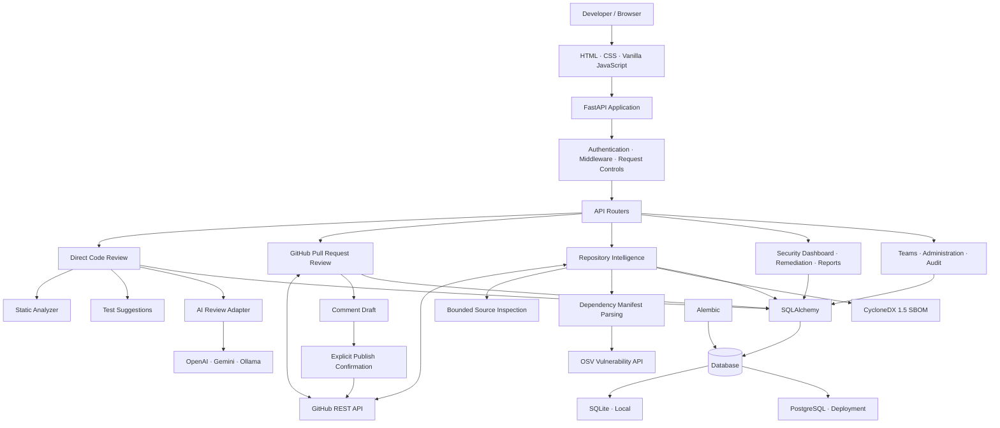

# CodeGuard AI — System Architecture

## 1. Overview

CodeGuard AI is a browser-based application backed by FastAPI. It combines deterministic static checks, optional AI-assisted review, GitHub integration, repository dependency intelligence, and security operations.

The application is modular: API routers validate and authorize requests, service modules orchestrate business logic, provider adapters isolate external AI APIs, and SQLAlchemy persists account-scoped records.

## 2. High-level architecture

## 3. Application layers

| Layer | Location | Responsibility |
|---|---|---|
| Web UI | `app/static/` | Browser interface for code review, GitHub workflows, analytics and security operations |
| API | `app/api/` | HTTP endpoints for authentication, reviews, GitHub, collaboration and security |
| Core | `app/core/` | Configuration, authentication, security helpers and request middleware |
| Schemas | `app/schemas/` | Pydantic request and response validation |
| Services | `app/services/` | Review orchestration, static analysis, AI provider calls, GitHub operations, persistence and audit |
| Models | `app/models/` | SQLAlchemy entities |
| Database | `app/db/` | Engine, session factory and database initialization |
| Migrations | `alembic/` | Versioned schema changes |

## 4. Main request flows

### 4.1 Direct code review

1. The browser submits a filename, language, source text and optional AI provider choice.
2. FastAPI validates the request and applies authentication and request controls.
3. The review service invokes the static analyzer and test suggestion service.
4. If configured, the AI adapter calls the selected provider and validates its structured response.
5. The service returns findings, a score, summary, suggested improvements and test suggestions.
6. Structured review results and audit metadata are saved for the authenticated user.

The service does not execute submitted source code or generated tests.

### 4.2 GitHub pull-request review

1. An authenticated user supplies repository coordinates, a pull-request number, and an authorized token or GitHub App installation reference.
2. The GitHub service reads pull-request metadata and changed files.
3. The current PR diff analysis is Python-focused.
4. The application returns findings and optional line-specific comment drafts.
5. Publishing requires a separate explicit confirmation (`PUBLISH_COMMENTS`).
6. The application publishes only a GitHub `COMMENT` review event. It does not approve, request changes, merge, or edit source files.

Tokens are request-scoped and are not persisted.

### 4.3 Repository intelligence scan

1. An authenticated user starts a read-only scan using a fine-grained GitHub token or GitHub App installation.
2. The service reads a bounded repository tree and supported files.
3. Static heuristics inspect supported source languages.
4. Supported dependency manifests are parsed; exact pinned versions can be checked against OSV.
5. A CycloneDX 1.5 JSON SBOM is generated from successfully parsed dependency declarations.
6. Findings and scan output are stored under the requesting account.

The scanner does not clone the repository, install dependencies, execute build scripts, run tests, or execute repository code.

### 4.4 Security operations

Saved repository scans feed the account-scoped security dashboard, remediation states, high-priority finding views, team summaries, and PDF/XLSX/CSV exports. Team views include only repositories registered and shared with that team.

Schedule records store daily/weekly preferences only. A separate external runner is required to execute scans; the application does not provide a background scheduler or store long-lived GitHub credentials for this purpose.

## 5. Persistence

- SQLAlchemy is used as the persistence layer.
- SQLite is the default local-development database.
- PostgreSQL is supported for Docker-based deployment.
- Alembic manages versioned schema migrations.
- Review history, accounts, repositories, teams, audit events, remediation state and schedule configuration are persisted.
- Access to review history and security data is scoped to the authenticated user or authorized team/admin role.

## 6. External integrations

| Integration | Purpose | Data / permission boundary |
|---|---|---|
| OpenAI | Optional AI-assisted review | Submitted source may be sent to OpenAI when selected |
| Google Gemini | Optional AI-assisted review | Submitted source may be sent to Gemini when selected |
| Ollama | Optional local model endpoint | Requests are sent to the configured Ollama endpoint |
| GitHub REST API | PR review and repository scans | Uses a request-scoped token or GitHub App installation token |
| OSV | Vulnerability lookup | Queries supported exact-version dependency coordinates |

Configure each integration deliberately and use only repositories and source code you are authorized to share.

## 7. Security and trust boundaries

- User authentication uses Argon2 password hashing and signed bearer tokens.
- Logout and password changes invalidate prior tokens through a token-version mechanism.
- Public registration creates developer accounts; it cannot self-assign administrator privileges.
- Security middleware adds request controls, request IDs, and response security headers.
- Submitted code is treated as untrusted data and is not executed.
- GitHub repository scanning is read-only and bounded.
- GitHub comment publishing is separated from analysis and requires explicit user confirmation.
- AI provider calls may transmit source code to the selected provider.
- Deployment requires HTTPS termination, correct trusted-proxy configuration, strong secrets, restricted CORS/hosts, protected backups and operational monitoring.

## 8. Known limitations

- Non-Python language checks are pattern-based heuristics, not full parsers or semantic analysis.
- GitHub pull-request diff analysis is Python-focused in this release.
- Repository dependency checks only assess supported manifest formats and exact pinned versions; they do not guarantee complete transitive dependency coverage.
- OSV service errors are represented as unknown rather than clean.
- The security risk score is a severity-weighted heuristic, not CVSS or a compliance score.
- Rate limiting is in-memory and per application process; multi-instance deployments need a shared gateway or distributed limiter.
- Schedule configuration does not execute jobs or send notifications.
- Docker and Nginx files are deployment starting points, not proof of a live production deployment.

For operational deployment requirements, see [`production-readiness.md`](production-readiness.md) and [`launch-checklist.md`](launch-checklist.md).
